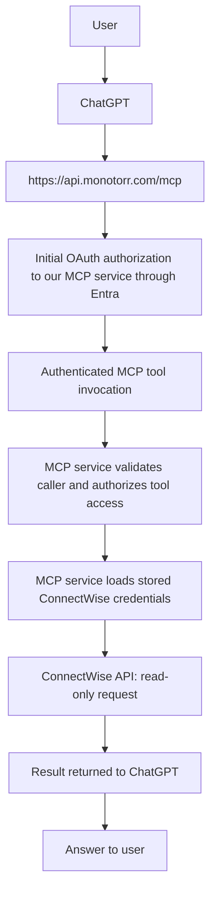

# ConnectWise MCP Product Architecture

Status: agreed product architecture and operating model for future implementation. Phase 1 is internal/private use. This document describes the intended product; it does not claim that the setup console, persisted configuration, or production OAuth integration is already implemented.

This is a documentation-only reference. It authorizes no application changes, Azure resources, authentication changes, or deployment. The existing fail-closed HTTP behavior remains in force. Implementation must satisfy the compatibility and security gates in [ChatGPT / Entra Authentication Design](CHATGPT_ENTRA_AUTHENTICATION_DESIGN.md) and preserve [Phase 1 Hardening](PHASE1_HARDENING.md).

## Core Product Model

The product is a persistent ConnectWise MCP service. An MSP administrator configures the ConnectWise connection once in our web application. Once securely configured, authorized, and operational, the service remains available to ChatGPT and other supported MCP-capable clients independently of the setup console's browser session.

The intended user experience is:

1. The administrator signs into our web console using Microsoft Entra.
2. The administrator configures the ConnectWise connection.
3. The application securely stores the ConnectWise connection details.
4. The MCP service becomes active once the connection and required security configuration are valid.
5. The user adds `https://api.monotorr.com/mcp` as a custom MCP connector in ChatGPT.
6. ChatGPT completes the initial, one-time OAuth linking and user authorization for our MCP service.
7. The MCP service uses the previously stored ConnectWise credentials to execute read-only ConnectWise API calls.
8. The user has normal conversations with ChatGPT using the ConnectWise MCP tools.

Normal usage does not require returning to the setup console. The administrator returns only to change ConnectWise settings, rotate credentials, test or reconnect the integration, manage access, or troubleshoot configuration.

Initial OAuth linking is separate from ongoing token validation and renewal. Expiration, revocation, policy changes, or disconnection can require reauthorization in the MCP client; they do not make normal operation depend on keeping the setup console logged in.

## Separate Authentication Domains

### 1. Application / User Identity

Microsoft Entra is the identity provider for our application and MCP authorization. Its purpose is to answer:

> Who is this user, and are they allowed to configure or use this MCP service?

An authenticated identity must also be authorized for the requested activity. Permission to configure the service and permission to invoke its MCP tools are distinct responsibilities, even when the initial internal user has both.

Phase 1 does not use Entra to administer Microsoft 365, call Microsoft Graph, access Exchange, SharePoint or Intune, access tenant administration APIs, request elevated Microsoft 365 permissions, or use GDAP. Microsoft 365 administrative permissions are not a product prerequisite.

Application registration and consent configuration for identity/OAuth must not be interpreted as permission to administer a customer's Microsoft 365 tenant. Entra identity and application authorization remain separate from the ConnectWise connection.

### 2. ConnectWise Service Credentials

ConnectWise authentication is independent of Entra. The ConnectWise administrator:

1. Creates a dedicated ConnectWise API User / API Member.
2. Assigns the required read-only ConnectWise security role.
3. Generates the ConnectWise public/private API key pair through ConnectWise.
4. Enters the required connection details into our setup UI.

The application securely stores those credentials and uses them when its backend calls ConnectWise. This architecture does not redefine ConnectWise's permission model or infer particular security-role permissions. The ConnectWise administrator is responsible for configuring and verifying the dedicated member's required read-only access.

Expected configuration fields:

| Field | Purpose |
| --- | --- |
| ConnectWise server URL | Identifies the configured ConnectWise API server |
| Company ID | Identifies the ConnectWise company |
| Public Key | Dedicated API member authentication material |
| Private Key | Dedicated API member secret |
| Client ID | Required ConnectWise API client identifier |

**The private key must never be returned to the browser after save.** Configuration status must not expose the saved private key. Credential replacement is a control-plane operation; subsequent reads must not redisplay the stored secret.

The service uses the permissions of the configured ConnectWise API member. Signing in through Entra does not grant ConnectWise permissions or translate the user's Microsoft permissions into ConnectWise access.

## Control Plane vs Tool Plane

### Control Plane

The control plane is the human-facing setup and configuration application. `/setup` is an example route, not a route created by this document.

Its responsibilities are:

- Entra sign-in and authorization to configure the integration.
- ConnectWise connection configuration.
- Secure credential storage.
- Connection testing and status display.
- Future credential rotation and access management.

This is where the administrator configures the integration. It writes service-owned configuration for use by the runtime; it does not have to relay each MCP request.

### MCP / Tool Plane

The tool plane is the machine-facing endpoint:

`https://api.monotorr.com/mcp`

Its responsibilities are:

- Authenticate the MCP client/user through the agreed OAuth boundary.
- Expose the read-only MCP tools and authorize access to them.
- Retrieve service-owned ConnectWise configuration.
- Call the configured ConnectWise API.
- Return structured results to the MCP client.

The MCP client must never provide ConnectWise credentials. The MCP endpoint must never accept ConnectWise public/private keys through tool arguments, HTTP headers, query parameters, or per-request configuration. It must not use caller-supplied connection settings to select a ConnectWise instance or replace service credentials.

Configuration is service-owned. The runtime configuration-provider interface supplies stored configuration after caller authorization; it is not a facility for accepting credentials from ChatGPT. Entra access tokens authorize access to the MCP service and are not passed through to ConnectWise.

These are conceptual planes within the separate ConnectWise MCP product. This document does not prescribe separate executables or Azure resources for each plane.

## Request Flow

### Administrator setup flow

Activation requires valid service configuration and the required authentication protections. A saved credential alone does not authorize public HTTP exposure.

### Operational flow

After initial linking, normal calls use the MCP client's valid OAuth access token. The service validates and authorizes each MCP request before retrieving its ConnectWise configuration or executing a tool. Token renewal and any required reauthorization follow the authentication design; this product reference does not select new OAuth endpoints or change that design.

## Persistent Service Behavior

**Once ConnectWise configuration is complete and the MCP service is active, normal MCP usage does not depend on an active browser session in the setup console.**

The setup console is configuration and control infrastructure. It is not a proxy that must remain logged in. Closing its browser tab or ending its administrative session must not deactivate an otherwise healthy and authorized MCP integration.

The Azure-hosted service retains its service-owned configuration securely across normal operation and restarts. MCP access still depends on valid caller authorization, usable ConnectWise credentials, service availability, and network access to ConnectWise. Configuration changes and credential rotation occur through the authorized control plane.

## Thread Reference Model

Use the [Thread MCP developer guide](https://docs.getthread.com/super-magic/thread-mcp-server-developer-guide) as a conceptual UX and architecture reference only. The useful patterns are:

- A stable MCP endpoint.
- Streamable HTTP transport.
- An OAuth-based MCP connection.
- The user adds the MCP URL to ChatGPT.
- Initial browser sign-in and authorization establish the connection.
- Tools become available in the client after connection.
- The same MCP endpoint can later serve Copilot Studio.
- Service configuration remains behind the MCP boundary rather than being supplied as client credentials for the backend integration.

These patterns guide our intended experience. They do not make Thread a runtime dependency or imply that we are replicating its product. Do not copy its tool permissions, identity model, dynamic client-registration implementation, or backend integration details. In particular, its client setup instructions are not proof that our Entra-backed authentication will work without the compatibility tests documented for this repository.

## Phase 1 Constraints

| Area | Phase 1 decision |
| --- | --- |
| Primary client | ChatGPT first; Copilot later |
| Backend integration | ConnectWise only |
| MCP tool capability | Read-only ConnectWise tools; all write capabilities disabled |
| Initial operating scope | One internal MSP initially |
| Hosting | Azure-hosted persistent service |
| Product separation | Separate service from Monotorr; sharing the Microsoft/Azure tenant is acceptable |
| MCP endpoint | `https://api.monotorr.com/mcp` |
| Commercial scope | No commercial multi-tenancy yet |
| Billing | No billing or Stripe |
| Microsoft permissions | No Microsoft 365 administrative permissions or GDAP |

The hardened baseline preserves 39 read-only tools and removes all 16 create/modify/delete registrations. The setup-console operating model described here is intended future implementation, not an assertion that the current hardened checkout already provides a web UI or persisted secret storage.

## Security Principles

The following are architectural invariants:

- Fail closed when authentication, authorization, or required service configuration is missing or invalid.
- Use a dedicated read-only ConnectWise API user/member with independently verified permissions.
- Keep MCP write tools disabled and retain runtime protection against ConnectWise writes.
- Treat ConnectWise configuration and credentials as service-owned.
- Accept no per-request ConnectWise credentials through the MCP boundary.
- Never display or return the saved private key to the browser.
- Store secrets securely, ultimately in Azure Key Vault; never embed them in client-side code or expose them through diagnostics.
- Keep MCP caller authentication separate from ConnectWise authentication.
- Depend on no WYRE-hosted infrastructure.
- Add no telemetry unless explicitly approved.
- Keep configuration and runtime service logically separate from Monotorr even when they share its Azure tenant.

Secure persistence and Key Vault integration are future implementation work. This document does not weaken the current HTTP startup refusal or authorize a storage/authentication workaround.

## Future Evolution

| Phase | Intended progression |
| --- | --- |
| Phase 1 | ConnectWise + ChatGPT for one internal MSP; persistent read-only service and internal setup/control model |
| Phase 2 | Same MCP endpoint + Copilot Studio, with its own tested client authorization configuration |
| Phase 3 | Commercial hosted version with multi-tenancy, customer onboarding, stronger tenant isolation, expanded web configuration, billing/Stripe, usage controls, audit, credential rotation, and customer-specific authorization |

The commercial product should evolve from the same core MCP architecture rather than requiring a rewrite. Preserve the separation between identity, service configuration, and read-only tool execution as the product grows. Phase 3 expands the internal setup/control model into customer-facing onboarding and administration; it does not imply that Phase 1 normal usage needs an administrative browser session.

Future phases require their own implementation plans and authorization. In particular, a shared endpoint is not itself a tenant-isolation mechanism, and sharing an Azure tenant does not justify sharing Monotorr's application identities or secrets.

## Project Invariant

Entra answers:

> Who is allowed to use/configure this application?

ConnectWise API credentials answer:

> What ConnectWise instance can the MCP service query, and with what ConnectWise permissions?

**These two concerns must remain separate throughout the implementation.**
