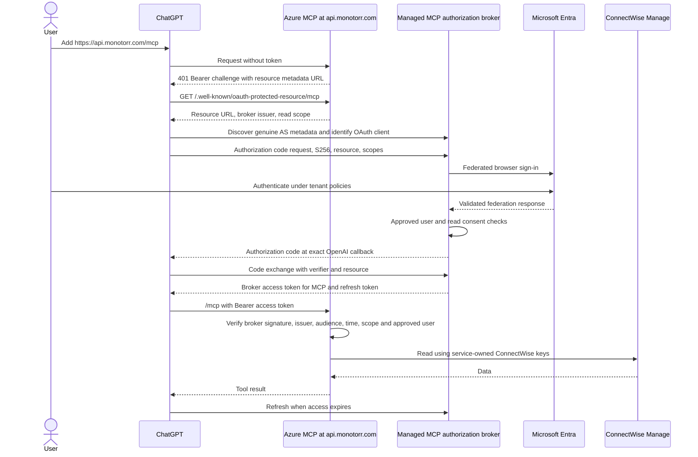

# MCP Authorization Broker Options

> **Selection/implementation update, 2026-10-04:** Descope was selected. Actual resource discovery independently advertises S256, DCR and `connectwise.read`/`offline_access`; CIMD is not advertised. Monotorr Entra SAML/JIT login and approved-user state passed. Node resource-server auth and tool metadata are implemented; ChatGPT exchange, real MCP claims/resource binding, refresh and Azure deployment remain live gates. The comparison below is decision history; exact current values are in [ChatGPT / Descope live test](CHATGPT_DESCOPE_MCP_LIVE_TEST.md).

Research date: 2026-10-04. Design only; no implementation, dependencies, credentials, app registrations, Azure resources, or deployment changes. Canonical repository: `/Users/rleon/Development/connectwise-mcp`.

**Recommendation: use a managed MCP authorization server federated to Entra, with Descope Agentic Identity Hub as the first candidate to validate.** Auth0 is the principal alternative. Keep the MCP service in Azure and the public resource URL `https://api.monotorr.com/mcp`. The broker becomes the actual MCP token issuer; Entra remains the sole source of user authentication. No custom OAuth server is necessary on the evidence reviewed.

Product capabilities below are documentation findings, not successful tests in our accounts. Prices are rough USD figures from current public pages, not quotes. The existing [compatibility checklist](ENTRA_CHATGPT_COMPATIBILITY_CHECK.md) and [hardening boundary](PHASE1_HARDENING.md) remain relevant; this document supersedes their conditional direct-Entra recommendation following the user-reported tenant test.

## Why Direct Entra Failed

The actual tenant-specific discovery test returned `code_challenge_methods_supported: null`, as reported by the project owner. Runtime S256 support does not satisfy discovery advertising. OpenAI requires advertised S256, code flow, resource handling and token validation on each request; it supports predefined clients, CIMD and DCR. [OpenAI authentication](https://developers.openai.com/plugins/build/auth).

Current MCP authorization separates the resource server from its authorization server. CIMD is recommended; preregistration remains an option, while DCR is retained for compatibility. [MCP authorization](https://modelcontextprotocol.io/specification/2026-07-28/basic/authorization).

The correct replacement has **two independent trust relationships**:

1. ChatGPT performs MCP OAuth with the broker. The broker advertises and implements its own capabilities, manages consent/client registration/refresh, and signs access tokens for our MCP resource.
2. The broker authenticates users through Entra using established OIDC or SAML federation. This ordinary federation flow does not require Entra to be an MCP authorization server.

The broker's issuer, keys and tokens are real and distinct from Entra's. Our PRM points to that broker issuer. Our API verifies broker tokens and rejects direct Entra tokens. This is not an Entra discovery rewrite or a pass-through token proxy.

### Microsoft/Azure-native assessment

**No Microsoft-managed service was verified in this review as a complete, compliant replacement for this particular ChatGPT authorization-server flow.** This is a bounded finding, not proof that no future service or external-tenant configuration can work.

| Option | What it provides | Does it resolve our failure? | Fit, cost and complexity |
| --- | --- | --- | --- |
| App Service Authentication / Easy Auth | Token validation, authorization policy and preview PRM generation | No: it still references the configured authorization server. It does not make that server advertise S256 or supply Entra CIMD/DCR. | Useful optional Azure enforcement later; not a broker replacement. App hosting costs; policy/backend isolation work. |
| Azure API Management / Azure AI Gateway | MCP gateway, PRM/challenge policies and JWT validation | No by itself: the identity provider still issues tokens. Configuring an OAuth provider does not turn APIM into an authorization server. | Optional governance layer; Azure consumption/tier costs and added routing complexity. Not needed for one user. |
| Entra External ID external tenant | Separate CIAM issuer, user flows and OIDC federation | Potential separate issuer to investigate, **not verified**: no established evidence here of the complete advertised-S256, resource, client-registration and ChatGPT exchange contract. Do not infer failure or success from the workforce tenant test. | Microsoft-managed; code/PKCE, predefined apps, refresh and API permissions exist. CIMD/DCR compatibility not established. Requires another tenant and live tests; identity usage/policy costs. Not the simplest proven choice. |
| Azure AD B2C | Legacy CIAM issuer with federation | Not a new-project recommendation; no complete ChatGPT/resource compatibility verification here. | Closed to new customers since May 2025; existing customers require separate lifecycle and protocol assessment. |

Evidence: [Easy Auth MCP](https://learn.microsoft.com/en-us/azure/app-service/configure-authentication-mcp), [APIM MCP security](https://learn.microsoft.com/en-us/azure/api-management/secure-mcp-servers), [APIM OAuth configuration scope](https://learn.microsoft.com/en-us/azure/api-management/api-management-howto-oauth2), [External ID OIDC federation](https://learn.microsoft.com/en-us/entra/external-id/customers/how-to-custom-oidc-federation-customers), [External ID OAuth endpoints/capabilities](https://learn.microsoft.com/en-us/entra/external-id/customers/migrate-from-cognito-to-external-id), [B2C lifecycle](https://learn.microsoft.com/en-us/azure/active-directory-b2c/faq).

APIM credential manager handles outbound OAuth credentials; it is not our inbound ChatGPT issuer. Entra Agent ID does not resolve the observed discovery omission. Neither Microsoft 365 administration nor downstream Microsoft API access is needed for this application.

## Candidate Options

PRM is a **resource-server responsibility** for every candidate: our service must publish it and point at the selected issuer. A vendor supplying discovery/JWKS does not automatically publish metadata at `api.monotorr.com`.

### Capability comparison

“Supported” means documented product capability, subject to enabling/configuring it. All candidates still require inspection of actual discovery and a live ChatGPT test.

| Product | Deployment / Entra federation | Code / PKCE | MCP-specific support | DCR | CIMD | Predefined client | Refresh | Resource/audience |
| --- | --- | --- | --- | --- | --- | --- | --- | --- |
| **Descope Agentic Identity Hub** | Managed service; Entra SAML and OIDC SSO | OAuth 2.1; discovery explicitly shows S256 | Dedicated MCP resource, discovery, consent, scopes and policies | Yes, configurable | Yes, configurable with approved domains | Yes; explicit client-resource policy needed | Yes; consent/session expiry applies | MCP URL included in token audience; scoped resource tokens |
| **Auth0 Auth for MCP** | Managed service; enterprise federation, including generic Entra OIDC | Modern code/PKCE; strict third-party code flows require PKCE | GA MCP offering, API grants, consent and resource profile | Yes; open registration must be explicitly controlled | Admin-approved metadata import is GA; do not equate this with unrestricted automatic URL discovery | Yes | Yes; public strict clients rotate by default | Native `resource` compatibility profile must be enabled; API identifier is our URL |
| **WorkOS AuthKit / Connect** | Managed service; documented Entra OIDC/SAML | OAuth 2.1; published AS metadata includes S256 | MCP discovery, CIMD, resource indicators and consent | Yes, configurable | Yes, configurable | Yes, Connect OAuth application | Yes with `offline_access` | Configure exact resource indicator; token audience then matches it |
| **Keycloak** | Self-hosted; generic Entra OIDC/SAML identity brokering | Code/PKCE; OAuth 2.1 controls configurable | Official MCP integration guide | Yes; registration policies/tokens matter | Yes, **experimental** | Yes | Yes; rotation/offline/session policies configurable | Native RFC 8707 **experimental** feature; resource URL and audience configuration required |

Sources: [Descope overview](https://docs.descope.com/mcp), [discovery](https://docs.descope.com/agentic-identity-hub/core-components/mcp-servers/discovery-url), [registration methods](https://docs.descope.com/agentic-identity-hub/core-components/mcp-servers/registration-methods), [Entra federation choices](https://docs.descope.com/auth-methods/sso/sso-setup-suite); [Auth0 MCP](https://auth0.com/ai/docs/mcp/overview), [GA release](https://auth0.com/blog/auth0-auth-for-mcp-servers-generally-available/), [PKCE/resource API](https://auth0.com/docs/api/authentication/authorization-code-flow-with-pkce/authorize-with-pkce); [WorkOS MCP](https://workos.com/docs/authkit/mcp), [metadata](https://workos.com/docs/reference/workos-connect/metadata), [Entra OIDC](https://workos.com/docs/integrations/entra-id-oidc); [Keycloak MCP](https://www.keycloak.org/securing-apps/mcp-authz-server), [administration and brokering](https://www.keycloak.org/docs/latest/server_admin/index.html).

### Operations, licensing and Phase 1 fit

| Product | Azure suitability | Licensing / rough cost | Complexity | Security tradeoff and Phase 1 verdict |
| --- | --- | --- | --- | --- |
| Descope | Azure MCP validates vendor JWTs; no broker infrastructure to operate. Dedicated/custom deployment arrangements require vendor confirmation. | Proprietary managed service. Free tier lists 3 SSO connections and 2,000 monthly active consents; Pro starts at $249/month billed annually. Custom domain/custom OIDC provider features are paid; confirm MCP/federation entitlements. | Low to moderate: hosted federation/consent configuration plus resource-server verifier. | Adds external identity processor and vendor outage dependency. Registration defaults are too broad for us. **Best initial fit**, subject to registration/refresh tests and approved-user enforcement. |
| Auth0 | Azure app validates Auth0 JWTs. Public managed service; private deployment is contractual, not a self-hostable Azure package to assume. | Proprietary managed service. Free tier currently lists one enterprise connection; published B2B starting figures are approximately $150/month Essentials and $800/month Professional. Verify applicable MCP/SSO entitlements; B2C prices are not the B2B budget. | Low to moderate with generic federation and fixed client; more policy work for third-party/organization flows. | Mature identity platform; new third-party profiles have compatibility restrictions. **Credible alternative**, not an unconditional drop-in. |
| WorkOS | Azure backend validates AuthKit JWTs; no self-hosted AS offering established here. | Proprietary managed service. AuthKit free tier; enterprise SSO approximately $125/connection/month; custom domain about $99/month. Confirm Connect entitlements and commercial pricing. | Moderate once custom scope/role configuration is included. Standalone Connect adds a login-completion integration. | Strong documented discovery/resource behavior, but CIMD/DCR custom scopes need extra support/configuration. **Viable, less simple for this exact scope model.** |
| Keycloak | Containers/VMs or AKS plus supported persistent database, TLS, backups, upgrades and monitoring. | Apache-2.0; no community software license fee, but Azure infrastructure and operations/support cost. Managed Keycloak providers add another contractual vendor to assess. | High relative to one user: operate a security-critical Java service and database. | Maximum hosting/control; experimental MCP features and patching burden. **Fallback if self-hosting becomes a hard requirement**, not first choice. |

Current commercial evidence: [Descope pricing](https://www.descope.com/pricing), [Auth0 pricing](https://auth0.com/pricing), [Auth0 B2B price examples](https://auth0.com/blog/whatever-you-are-building-auth0-has-a-plan/), [WorkOS pricing](https://workos.com/pricing), [Keycloak license](https://github.com/keycloak/keycloak/blob/main/LICENSE.txt). Free tiers may suffice for evaluation; they do not establish production SLA, residency, retention or feature entitlement.

### Product-specific cautions

**Descope:** CIMD/DCR clients automatically receive resource access; this does not approve the user. Its defaults enable DCR and disable CIMD. Configure approved domains/client verification, a restricted Entra-only consent flow and explicit staff policy. Keep broad “all authorization information” token inclusion disabled unless a reviewed claim mapping needs it. [MCP settings](https://docs.descope.com/agentic-identity-hub/core-components/mcp-servers/settings). Resource audience may be an array; accept our exact audience member, not arbitrary project tokens. [Resource tokens](https://docs.descope.com/resources). Refresh support exists, but the actual MCP template's rotation/replay handling and consent expiry must be tested; inbound refresh is documented as absent from the audit trail. [Refresh grant](https://docs.descope.com/identity-federation/inbound-apps/grant-types/refresh-token).

**Auth0:** use a generic OIDC back-channel connection to Entra with claims in the ID token; that connection does not normally call UserInfo. Avoid an Azure-specific profile/group-enrichment configuration that adds Graph permissions. [Generic OIDC connection](https://auth0.com/docs/authenticate/identity-providers/enterprise-identity-providers/oidc). Strict third-party clients currently do not support OIDC scopes/ID tokens or `id_token_hint`, and Organization access has explicit opt-in requirements. ChatGPT's automatically requested login scopes therefore need a specific live test. [Third-party controls](https://auth0.com/docs/get-started/applications/third-party-applications/security-controls). Admin CIMD import and an automatic-discovery capability flag have different documented lifecycle labels; verify the chosen route rather than advertising unsupported behavior. [CIMD registration API](https://auth0.com/docs/api/management/v2/clients/post-clients-cimd-register), [tenant settings](https://auth0.com/docs/api/management/v2/tenants/patch-settings). Enable the native resource profile; never substitute a resource-stripping proxy. [Resource compatibility](https://support.auth0.com/center/s/article/mcp-audience-error-with-auth0).

**WorkOS:** dynamically registered clients receive standard OIDC scopes; custom permission scopes require an environment-wide default arranged with support. Connect tokens do not automatically include a permissions claim; roles need an appropriate template or server-side permission lookup. Fixed clients can have assigned scopes. [Connect claims and scopes](https://workos.com/docs/authkit/connect/token-claims). Standalone Connect requires our login endpoint to complete authentication through its API, making it less attractive when no console/login application exists yet. [Standalone flow](https://workos.com/docs/authkit/connect/standalone). Its refresh endpoint is documented. [Token grants](https://workos.com/docs/reference/workos-connect/token).

**Keycloak:** enable and test genuine resource-indicator support, not the guide's alternative scope-only audience mapping when `resource` is otherwise ignored. Pin a maintained version and review experimental-feature risk. Fixed clients avoid experimental CIMD but do not remove the native resource-indicator caveat. No community extension or hand-built discovery shim is part of this recommendation.

## Recommended Phase 1 Choice

**Select Descope managed MCP authorization for a limited validation pilot.** It explicitly documents the field that failed Entra discovery, all three client-registration choices, resource-bound tokens and federation without requiring an application login bridge. That makes it the clearest low-code candidate for one internal user. The recommendation remains conditional on actual tenant metadata and ChatGPT exchange/refresh tests.

Proposed configuration, not actions performed:

1. Create a dedicated Descope project/resource for this service, separate from Monotorr. Resource is exactly `https://api.monotorr.com/mcp`; define only `connectwise.read`. No Connection/Vault integration for ConnectWise.
2. Use **Entra SAML SSO** for the initial user, with application assignment required and that employee explicitly assigned. SAML avoids Graph-dependent profile lookup and the workforce discovery issue. Configure an immutable subject/identity mapping. Entra OIDC SSO with only login scopes is also viable if the vendor connection is verified to avoid Graph enrichment; it is an alternative federation leg, not direct MCP authorization. Descope documents both federation approaches. [Bring existing identity through federation](https://docs.descope.com/mcp/bring-your-own-auth).
3. Permit only the designated Entra connection and approved user; disable local-password/social/open-signup alternatives for this flow. User records in the broker are identity mappings, not a requirement for another user password. Enforce staff approval again in our API against an immutable, verified broker-user identity.
4. Prefer CIMD with the exact ChatGPT metadata identity and permitted domain, copying the exact callback shown by ChatGPT. Verify its actual client-auth method intersection, including current plural-method negotiation. If CIMD fails that test, use a supported predefined client. Leave open DCR disabled for Phase 1. Do not assume CIMD guarantees `private_key_jwt`; a public `none` route needs compliant refresh replay protection.
5. Keep user consent for the read scope. Configure short-lived access tokens and controlled refresh/consent lifetime. ChatGPT holds refresh tokens; our resource server does not. No configuration-console session is required to keep the connection usable.

The broker sits in the **authorization flow**, not the tool-data path. It sees login/profile identifiers, client/resource metadata, scopes, consent, tokens and operational metadata such as IP addresses. It need not receive ConnectWise keys, tickets, tool arguments/results or our application logs. Do not enable vendor downstream credential vaults, traffic proxies, token-exchange/OBO features or broad telemetry SDKs for this use case. Review provider retention, region, subprocessors, availability and administrative access before production approval.

ConnectWise remains administrator-configured: dedicated API user/member, documented read-only role, server URL, Company ID, Public Key, Private Key and Client ID securely stored by our service. Neither ChatGPT nor the broker supplies these credentials, and no broker token is forwarded to ConnectWise.

## Future Commercial Fit

**Phase 2: same resource URL, Copilot Studio as a separate OAuth client.** Initially use its documented manual OAuth configuration with a separate client/credential and its generated callback. Keep the same issuer, API audience, read scope and user policy; extend the allowed-client policy deliberately. Copilot Studio also documents dynamic/discovery options, but these are not a reason to enable unrestricted registration now. Test actual resource transmission, PKCE, refresh and tool discovery before rollout. [Copilot Studio MCP connection](https://learn.microsoft.com/en-us/microsoft-copilot-studio/mcp-add-existing-server-to-agent), [callback/client setup](https://learn.microsoft.com/en-us/microsoft-copilot-studio/mcp-create-new-server). Microsoft 365 Copilot plugin authentication is a different product path and is not assumed here.

The linked Microsoft OAuth setup instructions confirm manual client ID/secret configuration, authorization/token/refresh URLs, optional scopes and a generated redirect URI. They describe Copilot Studio as an OAuth **client**, not a Microsoft authorization-server replacement. They do not establish PKCE S256 or RFC 8707 resource handling, and do not change ChatGPT's discovery requirements. Use Streamable HTTP and check applicable Power Platform connector data policies in Phase 2. [Configure OAuth 2.0 authentication](https://learn.microsoft.com/en-us/microsoft-copilot-studio/mcp-add-existing-server-to-agent#configure-oauth-20-authentication).

**Phase 3: retain the standards boundary, introduce explicit customer isolation.** Descope has tenant-aware MCP examples; Auth0 Organizations and WorkOS organizations are credible alternatives. Keycloak supports organization/broker constructs but increases operations. [Descope multi-tenant MCP](https://docs.descope.com/mcp/examples/b2b-mcp-server).

Before commercialization, design customer enrollment, per-customer IdP connections, approved membership, configuration-admin roles, consent/audit retention and revocation. Bind a signed, validated customer context to a server-side ConnectWise secret reference. The same endpoint can serve multiple customers, but a client-supplied company ID or tool argument must never choose the security tenant or credentials. Changing organizations must require an authorized grant/context change; do not default to the first available customer.

Broker refresh can outlive an upstream Entra login. Disabling an Entra employee may not immediately cancel existing broker grants. Define deprovisioning and revocation latency without assuming Graph/SCIM synchronization. Short JWT lifetime plus broker grant revocation and an application deny policy are possible components, subject to tests. Multi-tenant support is not achieved merely by enabling a multi-tenant Entra application or adding organization claims.

Commercial provider selection must include per-connection/tenant pricing, residency, export/migration and supported feature lifecycle. Descope is the Phase 1 preference, not a commitment to implement billing, tenancy or customer onboarding now.

## Implementation Impact

All changes below are future work. No authentication code was implemented in this research pass.

| Repository boundary | Required future change |
| --- | --- |
| `src/http-server.ts`: `createHttpHandler({ authenticate, configProvider, allowedOrigins })` | Inject broker-token verification and approved-user authorization before configuration/MCP handling. Evolve the boolean result to preserve request-local identity and safe 401/403 distinctions; keep thrown/unexpected failures closed. |
| PRM routing | Serve public `https://api.monotorr.com/.well-known/oauth-protected-resource/mcp`; exact resource URL, broker issuer and read scope. Root well-known alias is optional only if it does not conflict with other Monotorr routes. No anonymous MCP execution. |
| Bearer challenges | Missing/invalid token: safe 401 with `resource_metadata`; insufficient scope: 403 with `insufficient_scope`. Test OpenAI tool-level `_meta["mcp/www_authenticate"]` recovery where appropriate. |
| `src/index.ts`, auth configuration/verifier | Strict issuer/audience/JWKS/algorithm settings, read scope, approved immutable user and allowed client policy. Replace direct-Entra claim assumptions; broker `sub`/user mapping and claims must be verified, not guessed. Startup must still reject incomplete authentication. |
| Tool descriptors / SDK integration | All 39 read tools declare OAuth read scope and `_meta.securitySchemes` mirror; ensure actual SDK wire output supports the required descriptor fields. Keep 16 write tools absent and low-level GET-only enforcement. |
| `configProvider` | Continue resolving service-owned CW configuration only after auth success. No caller-provided credentials or broker-owned CW vault. Key Vault remains a later, separate implementation. |
| Diagnostics | No Authorization headers, codes, refresh/access tokens, federation assertions, client secrets or CW keys in logs/errors. Sanitized auth failure codes only. |
| Existing inherited routes | Keep simulated OAuth authorization/token/DCR handlers unmounted. We host no custom authorization server or metadata rewriting layer. |

Use the existing JOSE verification foundation where appropriate; no vendor SDK is inherently required for standard JWT verification. A later implementation may select a maintained adapter, but adding an SDK suite, APIM or a login console is not part of this design. Health can remain shallow/public; origin validation, HTTPS verification and all auth-before-secret ordering remain intact.

### Acceptance gates before public deployment

| Gate | Required evidence |
| --- | --- |
| Genuine discovery | Selected broker's real metadata advertises `S256`, stable exact issuer, code/token/JWKS endpoints and the enabled registration method. Do not copy vendor sample metadata into production. |
| Resource binding | Authorization and token requests retain exact MCP resource; access and refreshed tokens include our audience and approved read scope. Unknown/conflicting resources are rejected, not mapped to a default audience. |
| ChatGPT interoperability | Actual CIMD method negotiation or predefined-client exchange works, exact callback accepted, requested OIDC scopes handled, no discovery shim. Inspector success alone is insufficient. |
| Identity and policy | Entra-only approved user succeeds; other tenant, unassigned same-tenant user, alternate login method, unauthorized client and direct Entra tokens fail. Verify what actual JWT subject/user claims identify. |
| Persistence/replay | Close any console, wait through access expiry, verify refresh and safe relinking. For public clients, prove compliant refresh rotation/replay detection. Confirm consent-expiry and deprovisioning behavior. |
| API enforcement | Validate every MCP request, including initialize/list/call; reject wrong issuer/audience/scope/signature/time. No configuration lookup/CW call on denial; no write registrations; sanitized logs. |
| Operational approval | Entitlements, costs, vendor identity-data processing, residency/retention, key/client rotation, outage handling and acceptable revocation interval reviewed. Broker outage or unknown keys must not permit authentication bypass. |

Entra federation uses login identity claims only. No Graph data permissions, Exchange, SharePoint, Intune, GDAP or Microsoft 365 administrative access is part of these gates. OIDC login scopes may be displayed under a Microsoft Graph category in the portal; that does not imply a need for directory/data API grants or profile-enrichment calls.

## Go / No-Go

**GO for the broker architecture and a separately authorized Descope validation pilot. NO-GO for direct workforce Entra under the tested discovery response, metadata spoofing, or public production deployment before the acceptance gates pass.** A maintained managed issuer federated to Entra is a reasonable alternative to owning an OAuth server. Descope is the best documented Phase 1 fit; Auth0 remains the fallback if its chosen client profile passes ChatGPT scope/discovery tests. Keep the current HTTP fail-closed behavior until a reviewed implementation is authorized and verified.
